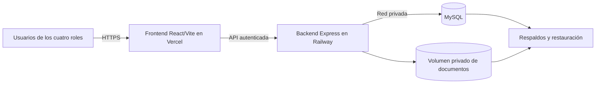

# Plan de trabajo para preparar el sistema y publicarlo en producción

Proyecto: `C:\xampp\htdocs\Tesis`. Fecha: 14 de octubre de 2026.

Estado al 15/10/2026: **preparación local implementada y validada; publicación e instalación institucional pendientes**. Ver [estado y evidencias por fase](estado-produccion.md) y [guía operativa](operacion-produccion.md). No se ha desplegado ni trasladado datos reales.

## 1. Objetivo y alcance

Resolver los bloqueos de seguridad, configuración, persistencia y operación; verificar los flujos de los cuatro roles; publicar primero en preproducción y pasar a producción después de cumplir los criterios de aceptación.

Conservar React/Vite, Express, MySQL, componentes existentes y reglas académicas/financieras. No reintroducir IA, migrar a PostgreSQL, sustituir el frontend por Next.js ni rehacer el proyecto para adaptarlo al alojamiento.

Este documento conserva el plan por fases. La ejecución local está detallada en el informe de estado; no implica contratación, rotación de secretos externos, limpieza de historial remoto, traslado de datos reales ni publicación. Esas acciones requieren destinos, responsables y resultados concretos revisables.

## 2. Arquitectura recomendada y alternativas

**Recomendación: frontend en Vercel; backend y MySQL en Railway; documentos en un volumen persistente privado del backend para la primera versión.**

Esta recomendación se basa en el código actual: Express utiliza transacciones MySQL, un pool de conexiones y archivos locales. Mantener el backend como servicio evita cambiar simultáneamente almacenamiento y modelo de ejecución. Vercel admite [Vite](https://vercel.com/docs/frameworks/frontend/vite) y [rewrites a APIs externas](https://vercel.com/docs/routing/rewrites). Railway ofrece [Express](https://docs.railway.com/guides/express), [MySQL](https://docs.railway.com/databases/mysql) y [volúmenes persistentes](https://docs.railway.com/volumes/reference).



El volumen del backend es distinto del volumen de MySQL. No se publicará como carpeta estática: las descargas conservarán la autorización existente. Comenzar con una instancia del backend si se utiliza volumen; verificar restricciones del proveedor para reinicios/despliegues. Para varias instancias, planificar almacenamiento privado de objetos.

| Opción | Ventaja para este proyecto | Trabajo adicional | Recomendación |
|---|---|---|---|
| Vercel frontend + Railway backend/MySQL + volumen privado | Conserva el stack y las transacciones existentes | Configuración, integración, persistencia y respaldos | Primera opción |
| Vercel frontend y Express + MySQL externo + objetos privados | Es técnicamente posible | Adaptar archivos, conexiones, límites y limitación distribuida | Elegir si se acepta trabajo adicional |
| Servidor propio/VPS para frontend, backend y MySQL | Control del proceso y disco | Administrar TLS, firewall, actualizaciones y recuperación | Alternativa si existe experiencia operativa |

### Si se quiere también el backend en Vercel

Vercel **sí soporta Express**, ejecutándolo como una función con Fluid compute. No debe considerarse incompatible con Node. [Documentación oficial](https://vercel.com/docs/frameworks/backend/express).

El proyecto admite documentos de 10 MB y los escribe en `backend/uploads`. Las funciones tienen un límite documentado de cuerpo de solicitud/respuesta de 4.5 MB. Esta alternativa necesita almacenamiento privado de objetos, cargas directas autorizadas, validación/finalización posterior y descargas compatibles; copiar el backend no resuelve la persistencia. [Límites de funciones](https://vercel.com/docs/functions/limitations), [archivos en funciones](https://vercel.com/kb/guide/how-can-i-use-files-in-serverless-functions).

También habría que ajustar pool MySQL y limitador de login al número de instancias. Son motivos para preferir un backend como servicio al principio, no una prohibición de usar Vercel.

El límite de funciones no se atribuye automáticamente a rewrites externos: en la opción recomendada se probarán cargas y descargas de 10 MB a través de la ruta real. Si el proxy no las admite, se usará acceso HTTPS directo al backend para esos endpoints, con CORS acotado y autorización.

### Costos y responsabilidad

No se promete alojamiento gratuito ni se fija precio. Revisar cómputo, MySQL, almacenamiento, respaldos, tráfico, crecimiento y condiciones de uso antes de contratar. Vercel Hobby está orientado a uso personal/no comercial; no asumir que cualquier uso institucional encaja. [Plan Hobby](https://vercel.com/docs/plans/hobby).

Un servicio MySQL en Railway no elimina las responsabilidades de permisos, configuración y restauración. Verificar qué cubre el servicio elegido. Los [respaldos de volumen](https://docs.railway.com/volumes/backups) deben acompañarse de recuperación consistente de DB y documentos.

## 3. Diagnóstico que orienta el trabajo

| Evidencia del proyecto | Acción | Prioridad |
|---|---|---|
| `.env` raíz versionado y secreto JWT local de prueba | Retirar secretos del versionado, rotarlos y validar producción | P0 |
| Login con credenciales demo y altas con `123456` de respaldo | Separar demo/producción y exigir credenciales explícitas | P0 |
| `/api/seed` montado, aunque requiere administrador | Deshabilitar seeds en producción, también por CLI | P0 |
| Usuario MySQL `root` en configuración actual | Usuario limitado para API y otro para migraciones | P0 |
| CORS local, logs de desarrollo y despliegue no definido | Configuración por entorno, HTTPS y manejo de errores | P0 |
| Archivos guardados por rutas relativas a compilación | Ruta persistente configurable común a carga, lectura y borrado | P0 |
| Migraciones dispersas y restauración no ensayada | Instalación reproducible y respaldo/restauración verificados | P0 |
| Conexiones administrativas adquiridas antes de `try`; borrado definitivo de matrícula | Completar manejo de errores y acordar protección del historial | P1 |
| Login limitado en memoria por proceso | Verificar IP del proxy y contador compartido antes de escalar | P1 |
| Pruebas visuales pendientes | CI y pruebas reales en preproducción | P0 |
| Auditoría y políticas de evaluación pendientes | Implementar solo reglas confirmadas | P1 / decisión |

**Corrección de la evaluación anterior:** `documentos.controller.ts` ya comprueba firmas básicas del contenido. No depende solo de extensión/MIME. El trabajo consiste en conservar y reforzar esa verificación; un encabezado ZIP, por ejemplo, no garantiza que un archivo sea un DOCX válido.

P0 bloquea el uso de datos reales. P1 debe resolverse o aceptarse explícitamente con alcance y responsable antes de abrir el acceso. La advertencia de bundle grande no sustituye los bloqueos P0.

## 4. Fases y dependencias

| Fase | Resultado | Depende de | Cierre |
|---|---|---|---|
| 0 | Arquitectura, presupuesto y operación acordados | Ninguna | Decisiones mínimas confirmadas |
| 1 | Secretos y cuentas protegidos | 0 | Sin secretos versionados ni credenciales demo utilizables |
| 2 | Backend preparado para producción | 1 | Configuración estricta y errores controlados |
| 3 | MySQL y migraciones reproducibles | 1–2 | Instalación y recuperación verificadas |
| 4 | Documentos privados y persistentes | 0–2 | Integridad y permisos después de reinicio/redeploy |
| 5 | Vercel integrado con backend | 2–4 | HTTPS, API, navegación y documentos funcionando |
| 6 | Regresiones, navegador y concurrencia | 3–5 | Matriz de aceptación aprobada |
| 7 | Respaldos, monitorización y reversión | 3–6 | Recuperación ensayada y responsable identificado |
| 8 | Publicación controlada | Todas | Lista de salida y autorización final |
| 9 | Mantenimiento | 8 | Seguimiento y respuesta a incidentes |

No se promete un número de días sin presupuesto, alojamiento, volumen de datos y disponibilidad para pruebas. Estimar cada fase al cerrar la fase 0.

## 5. Fase 0 — Decidir destino y operación

1. Confirmar la arquitectura recomendada o seleccionar backend en Vercel.
2. Distinguir demostración de tesis con datos ficticios de operación institucional real.
3. Identificar propietario de dominio, cuentas de alojamiento y facturación.
4. Elegir región cercana entre backend y MySQL; medir conectividad desde los usuarios previstos.
5. Estimar usuarios simultáneos, alumnos, documentos mensuales, almacenamiento y crecimiento.
6. Definir presupuesto, mantenimiento, pérdida máxima tolerable de datos (RPO) y tiempo de recuperación (RTO).
7. Separar desarrollo, preproducción y producción: bases, documentos y secretos distintos. Los previews no apuntan a la base real.

**Entregable:** ficha de arquitectura, costos estimados, responsables y decisiones. No contratar ni trasladar datos reales sin autorización.

## 6. Fase 1 — Secretos, cuentas y datos demo

### Tareas

1. Crear `.gitignore` raíz para secretos, archivos subidos, logs, respaldos y temporales. Mantener `.env.example` sin valores reales.
2. Retirar el `.env` ya rastreado del índice sin borrar la copia local necesaria. Agregarlo al ignore no elimina versiones anteriores.
3. Revisar exposición histórica y rotar secretos afectados. Si hace falta limpiar historial remoto, preparar impacto y procedimiento antes de ejecutar; no hacer force-push por inferencia.
4. Generar JWT aleatorio fuerte y separado por entorno, almacenado en el proveedor. Informar que rotarlo invalidará sesiones.
5. Quitar credenciales demo del login de producción y del build publicado.
6. Desmontar `/api/seed` y bloquear los scripts demo en producción.
7. Rechazar contraseñas omitidas en las altas que hoy usan `123456`, o implementar activación aprobada. No asumir que existe servicio de correo.
8. Revisar cuentas demo existentes y desactivarlas de forma controlada, conservando sus registros asociados.
9. Inventariar contraseñas legacy sin imprimirlas y planificar conversión/reset para retirar dependencia del cifrado de clave fija o texto plano. Mantener bcrypt.
10. Proteger cuentas de alojamiento/repositorio y evitar secretos en informes o logs.

**Archivos previstos:** `.gitignore`, `.env.example`, configuración, controladores de autenticación/altas, seeds, `LoginPage.tsx` y README.

**Aceptación:** secretos actuales fuera del versionado, exposición histórica tratada, producción sin defaults inseguros, altas inválidas rechazadas en backend y seeds inaccesibles incluso para administrador autenticado. Ningún dato histórico eliminado por aproximación.

## 7. Fase 2 — Configuración y seguridad del backend

### Tareas

1. Centralizar y validar entorno: `NODE_ENV`, puerto, JWT, MySQL, orígenes permitidos y almacenamiento. Producción debe fallar al arrancar si faltan valores necesarios.
2. Prohibir respaldos inseguros como DB `root`, contraseña vacía o secretos locales de prueba en producción.
3. Separar aplicación del arranque para pruebas y alojamiento; usar `PORT` del proveedor y JavaScript compilado, sin `ts-node-dev` en producción.
4. Configurar CORS por orígenes exactos. Acotar previews; no habilitar `*` con credenciales ni confiar en cualquier subdominio.
5. Configurar `trust proxy` para la cadena real Vercel/Railway. Probar IPs distintas y falsificación de `X-Forwarded-For`.
6. Mantener límite de login; definir contador compartido antes de múltiples instancias. Documentar reinicio/alcance si se empieza con una sola.
7. Añadir manejo central de errores y 404 JSON. No devolver SQL o stack ni registrar contraseñas, hashes, tokens o datos personales completos.
8. Completar adquisición protegida, rollback y liberación de conexiones en altas/ediciones administrativas pendientes, especialmente alumnos, profesores y apoderados.
9. Validar tipos, estados, IDs y referencias en todas esas operaciones; detectar inexistencia en vez de devolver éxito.
10. Revisar borrados definitivos e historial. Proponer cancelación/archivo, aplicando la política confirmada.
11. Configurar timeouts, cola y tamaño del pool según capacidad real; evaluar bcrypt asíncrono para no bloquear solicitudes concurrentes.
12. Revisar permisos por cada método API, conservando aislamiento e históricos de consulta del profesor.
13. Añadir readiness de MySQL y almacenamiento sin revelar datos, separada de liveness. La salud actual solo indica que responde el proceso.
14. Auditar dependencias y actualizar de forma dirigida con regresiones. Evitar `npm audit fix --force` indiscriminado.

**Aceptación:** pruebas de 400/401/403/404/409/429/500/503, IP real tras proxy, caída de DB y limpieza de conexiones. Sin acceso entre cuentas ajenas ni vulnerabilidades críticas sin tratamiento documentado.

## 8. Fase 3 — MySQL, migraciones y datos

### Tareas

1. Comparar estructura instalada, `schema.sql` y migraciones. No aplicar todas a ciegas sobre una base actualizada.
2. Consolidar orden/versiones para instalación nueva y actualización. No ejecutar migraciones por petición HTTP ni en cada arranque.
3. Configurar MySQL en el proveedor elegido, red privada cuando corresponda y TLS verificado en accesos externos.
4. Separar usuario limitado de aplicación y usuario de DDL/migraciones. Evitar exposición pública permanente de MySQL.
5. Definir UTC para instantes y `America/Lima` para presentación/calendario cuando corresponda; conservar fechas académicas y mes/año sin desplazarlos.
6. Verificar claves, índices únicos y bloqueos de pagos y matrículas. No eliminar duplicados históricos automáticamente.
7. Respaldar antes de migrar y comparar filas/totales/vínculos/importes antes y después. Mantener datos demo fuera de producción.
8. Probar con el usuario limitado las consultas de metadatos, `GET_LOCK`, `FOR UPDATE` y transacciones usadas por el sistema.
9. Diseñar compatibilidad con versión anterior y recuperación de esquema; no confundir rollback de código con rollback de DB.

**Aceptación:** instalación reproducible, actualización sin pérdida/reclasificación, repetición segura donde las migraciones sean idempotentes, persistencia desde otra conexión y restauración verificada. CI usa su propio MySQL de pruebas; nunca credenciales productivas para crear/borrar bases temporales.

## 9. Fase 4 — Documentos privados y persistentes

### Con volumen del backend

1. Introducir `UPLOAD_DIRECTORY` configurable, por ejemplo `/data/uploads`, común al middleware y controlador; hoy calculan rutas por separado.
2. Montar el volumen y verificar permisos. Mantenerlo separado de MySQL.
3. Trasladar documentos con inventario, checksums y relación a filas de DB. Reportar faltantes; no inventar archivos de respaldo.
4. Mantener descarga autenticada y alcance por documento; no exponer `/uploads` como estático público.
5. Conservar firmas, extensión y MIME existentes; reforzar DOCX con validación de estructura y límites de descompresión. Probar archivos truncados, ZIP disfrazado y tamaños excesivos; evaluar malware/cuarentena según uso.
6. Tratar archivo y MySQL como recursos distintos: limpieza compensatoria al fallar SQL y verificación de huérfanos. No afirmar atomicidad entre disco y DB.
7. Acordar retención/archivo antes de purgar documentos y controlar fallos de borrado.
8. Subir y descargar archivos de prueba, reiniciar y redesplegar; comprobar integridad y permisos.
9. Respaldar y restaurar volumen junto a DB, con acceso restringido.

### Si se eligen objetos privados

Crear adaptador para subir/leer/borrar/verificar objetos, conservar APIs y guardar una clave estable, no URL pública permanente. Autorizar cada descarga o emitir enlace de vida corta después de comprobar propiedad. La carga directa requiere autorización previa, validación/finalización posterior y limpieza de cargas abandonadas. Migrar referencias antiguas de forma compatible.

**Aceptación:** archivos disponibles después de reinicio/redeploy/restauración, descargas ajenas bloqueadas y fallo SQL sin falso éxito. Mantener 10 MB hasta autorizar otro límite.

## 10. Fase 5 — Frontend Vercel e integración

| Ajuste | Propuesta |
|---|---|
| Root Directory Vercel | `frontend` |
| Framework | Vite |
| Instalación | `npm ci`, con dependencias de compilación disponibles |
| Build | `npm run build` |
| Output Directory | `dist` |
| Variables frontend | Solo públicas; ninguna credencial JWT/DB/almacenamiento |
| Backend Railway | Contexto raíz del repositorio, `backend/Dockerfile`, Node 24, `dist/server.js` |
| Runtime backend | `NODE_ENV=production`, puerto y secretos del proveedor |

TypeScript está en devDependencies: el builder puede necesitar `npm ci --include=dev`; separar posteriormente dependencias de runtime. Fijar versión de Node compatible en desarrollo, CI y proveedor. El proxy de `vite.config.ts` solo sirve en desarrollo.

### Configuración implementada

Se eligió `VITE_API_BASE_URL` con API HTTPS directa; el cliente Axios la usa también para documentos. `frontend/vercel.json` configura la SPA y las cabeceras del frontend. El build en Vercel exige esa variable. No se configuró un rewrite API hacia un dominio ficticio. Cada entorno necesita su URL real y su origen exacto autorizado en backend; el proxy Vite sigue siendo solo de desarrollo.

### Tareas y aceptación

1. Elegir rewrite externo o `VITE_API_BASE_URL` pública explícita y mantener separación de entornos.
2. Configurar dominio/HTTPS; eliminar dependencia de `localhost` en flujo publicado.
3. No habilitar caché compartida de datos autenticados: cabeceras privadas/no-store para notas, pagos, perfiles y documentos.
4. Probar Authorization, login, revocación, filtros, errores y archivos de 10 MB por la red real.
5. Recargar/abrir directamente dashboard, curso/oferta, alumno y rutas personales.
6. Confirmar ausencia de credenciales demo y módulo IA en build.
7. Medir carga del frontend contra metas acordadas; tratar bundle grande según resultados, después de P0.

**Aceptación:** preproducción HTTPS con API y rutas SPA correctas, secretos fuera del frontend y documentos privados.

## 11. Fase 6 — CI, navegador y concurrencia

Crear pipeline, por ejemplo GitHub Actions, para instalar, compilar y ejecutar pruebas con un MySQL temporal de datos sintéticos. Auditar dependencias sin actualizar automáticamente el lockfile productivo.

Comandos de referencia; resultados reales, comandos adicionales y límites de la validación en [estado-produccion.md](estado-produccion.md):

```bash
# Backend
npm ci
npm run build
npm run test:profesores
npm run test:estudiantes
npm run test:payments
npm run test:payments:db
npm run test:integral
npm run test:sin-ia
npm run test:production

# Frontend
npm ci
npm run build
npm run test:session
npm run test:e2e
```

Si el runner impide workers, ejecutar los archivos `.test.cjs` en procesos independientes. Los 94 casos anteriores son una línea base, no aceptación de los nuevos requisitos productivos.

| Área | Casos obligatorios en preproducción |
|---|---|
| Sesión | Credenciales inválidas, 429, token inválido/vencido, desactivación, rol cambiado, logout y revocación tras contraseña |
| Administrador | Altas sin defaults, matrículas, periodos simultáneos, reportes y documentos |
| Profesor | Mis alumnos/grupos, notas/asistencia propias, IDs ajenos e históricos de consulta |
| Alumno | Cursos/periodos propios, notas, asistencia y pagos separados por concepto |
| Apoderado | Varios vínculos, ningún vínculo, ID ajeno, contraseña propia y finanzas bloqueadas |
| Pagos | Duplicados concurrentes, validaciones, fallo SQL y persistencia |
| Documentos | Firmas, límite 10 MB, permisos, interrupción, redeploy y recuperación |
| Red/navegador | CORS, proxy, rutas directas, recarga, caché corrupta y caídas sin HTML inesperado |
| Dispositivos | Escritorio/móvil, teclado, menú, formularios y tablas |
| Carga | Login/bcrypt, pool, pagos simultáneos, activaciones y lotes |

Definir usuarios simultáneos, tiempos de respuesta y error tolerable antes de medir. Registrar evidencia y plataforma de las pruebas visuales. Si la herramienta vuelve a impedirlas, comprobar desde una estación accesible y dejarlas pendientes hasta verificar.

**Aceptación:** casos críticos aprobados en el alojamiento real, aislamiento completo y objetivos de carga acordados cumplidos. Ninguna operación fallida se presenta como exitosa.

## 12. Fase 7 — Respaldos, auditoría y reversión

1. Confirmar RPO/RTO, retención y responsable institucional.
2. Programar respaldo DB/documentos, copia separada protegida y copia previa a migración; restaurar completamente en otro entorno.
3. Coordinar punto de corte/inventario o quiescencia para no respaldar DB y archivos inconsistentes. Verificar referencias al restaurar.
4. Monitorizar disponibilidad, errores 5xx, conexiones, espacio, fallos de archivos y ejecuciones de respaldo.
5. Documentar quién responde y cómo diagnostica, evitando datos sensibles en servicios de logs.
6. Reutilizar `registro_actividades` e historiales para auditoría. Confirmar consulta, conservación y comportamiento ante fallo antes de implementar el helper transaccional.
7. Ensayar rollback de código compatible con esquema. Vercel no revierte MySQL ni documentos al revertir frontend; restaurar una base antigua puede perder pagos posteriores.
8. Documentar publicación, recuperación, rotación y acceso administrativo de emergencia protegido.

**Aceptación:** recuperación con pagos, vínculos, notas y archivos, totales/checksums verificados y tiempo medido; responsables y procedimiento disponibles antes de abrir acceso real.

## 13. Fase 8 — Publicación controlada

1. Preparar commit/tag, cambios, evidencias, migraciones y reversión como entrega revisable.
2. Confirmar propietario, presupuesto, dominio, políticas pendientes y ventana de publicación.
3. Respaldar/verificar destino antes de migrar o trasladar datos. No cargar demos en producción.
4. Desplegar backend/almacenamiento, comprobar readiness y después frontend, manteniendo compatibilidad.
5. Ejecutar smoke tests con cuentas autorizadas de los cuatro roles, sin pagos ficticios ni pruebas destructivas en producción.
6. Abrir primero a un grupo reducido; ampliar cuando se mantengan los criterios.
7. Si hay fallo crítico, aplicar la reversión acordada y preservar escrituras válidas.

### Lista de salida antes de usar datos reales

- [ ] Secretos fuera de Git y credenciales expuestas rotadas.
- [ ] Credenciales demo/defaults retirados y seeds bloqueados.
- [ ] MySQL limitado, red controlada y configuración validada.
- [ ] HTTPS, dominio, CORS y proxy probados.
- [ ] Dependencias revisadas y migraciones reproducibles.
- [ ] Documentos privados y persistentes tras reinicio/redeploy.
- [ ] Carga/descarga de 10 MB verificadas por la red real.
- [ ] Pruebas automatizadas y visuales de cuatro roles aprobadas.
- [ ] Concurrencia medida contra objetivos acordados.
- [ ] Recuperación DB/documentos ensayada.
- [ ] Monitorización, responsable y reversión listos.
- [ ] Políticas relevantes de conservación/auditoría/visibilidad confirmadas.
- [ ] Autorización final sobre la entrega concreta.

## 14. Fase 9 — Mantenimiento

Revisar errores, capacidad, consumo y respaldos con periodicidad acordada. Actualizar dependencias mediante entregas probadas en preproducción. Ensayar restauraciones periódicamente y tras cambios importantes. Revisar cuentas/permisos y disponibilidad de responsables. Ampliar instancias después de resolver almacenamiento compartido y limitación distribuida.

## 15. Decisiones pendientes del propietario

| Decisión | Propuesta | Cuándo |
|---|---|---|
| Arquitectura | Vercel frontend + Railway backend/MySQL + volumen privado inicial | Fase 0 |
| Uso y presupuesto | Demostración o uso institucional; límite mensual y propietario de cuentas | Fase 0 |
| Dominio/región/capacidad | Definir según usuarios y cercanía backend/DB | Fase 0 |
| Archivos | Volumen inicial u objetos privados para escalabilidad | Fase 0/4 |
| Credenciales | Contraseña explícita o activación; cambio inicial obligatorio si se acuerda | Fase 1 |
| Historial/borrados | Cancelación/archivo según política aprobada | Fase 2 |
| Respaldo/auditoría | RPO/RTO, retención, consulta, responsable y fallo de registro | Fase 7 |
| Evaluaciones | Publicación, cierre/reapertura y ponderación; conservar reglas actuales mientras tanto | Antes de un flujo que dependa de ellas |
| Publicación | Aprobar entrega revisable tras los controles | Fase 8 |

Confirmaciones recibidas: uso institucional con datos reales, cuenta Vercel disponible, Railway aún sin cuenta y políticas de conservación/recuperación no definidas. No se programan purgas.

Los pendientes de evaluación no obligan a rehacer el módulo para alojarlo: confirmar qué comportamiento vigente acepta la institución. Conservar las reglas ya autorizadas: máximo un periodo activo, históricos de consulta del profesor, cierre de sesiones por contraseña y separación de pagos.

## 16. Entregables previstos

- Configuración y ejemplos de entorno sin secretos.
- Correcciones de seguridad y pruebas específicas.
- Configuración Vercel/backend/dominio/red documentada.
- Migraciones versionadas e instalación/actualización reproducibles.
- Almacenamiento privado persistente e inventario de archivos.
- CI y evidencias de preproducción por rol.
- Guías de respaldo, restauración, publicación y reversión.
- Informe de bloqueos resueltos, riesgos aceptados y pendientes.

## 17. Fuentes y límites del plan

Características revisadas en documentación oficial el 14 de octubre de 2026. Confirmar precios, límites, regiones y disponibilidad al contratar/configurar. La recomendación evalúa el encaje del código, no garantiza costos ni disponibilidad del proveedor.

- [Vite en Vercel](https://vercel.com/docs/frameworks/frontend/vite), [rewrites](https://vercel.com/docs/routing/rewrites) y [Express](https://vercel.com/docs/frameworks/backend/express).
- [Límites de funciones](https://vercel.com/docs/functions/limitations), [archivos](https://vercel.com/kb/guide/how-can-i-use-files-in-serverless-functions) y [plan Hobby](https://vercel.com/docs/plans/hobby).
- Railway: [Express](https://docs.railway.com/guides/express), [MySQL](https://docs.railway.com/databases/mysql), [volúmenes](https://docs.railway.com/volumes/reference) y [respaldos](https://docs.railway.com/volumes/backups).
- [Revisión integral](correccion-integral.md) y [retiro de IA](retiro-prediccion-ia.md): línea base y reglas existentes.

Histórico: al crear este plan el 14/10/2026 solo se inspeccionó código y se redactó el documento. En esa entrega no se modificó la aplicación, rotaron claves, contrataron servicios, migraron datos ni publicaron despliegues. Esa fue la entrega inicial del 14/10/2026. El 15/10/2026 se implementó la preparación local; el estado vigente por fase está en estado-produccion.md. Los criterios cloud/operativos siguen pendientes y no se deben marcar cumplidos por pasar pruebas locales.
